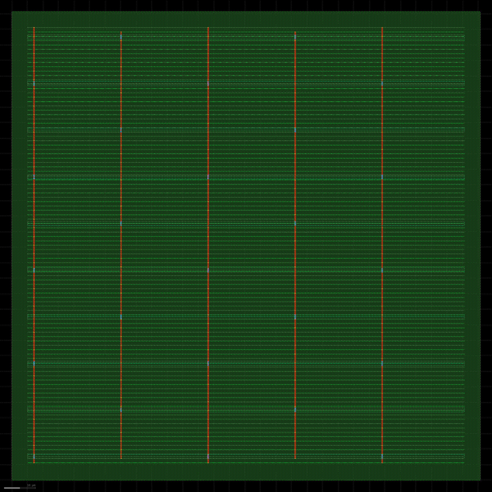
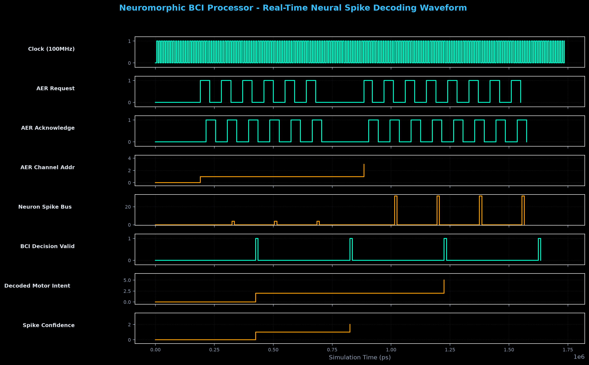

# Neuromorphic BCI: Spiking Neural Network Silicon Core

This core is a synthesizable bio-inspired Neuromorphic Processor designed for real-time Brain-Computer Interface (BCI) neural decoding and motor intent classification. Designed in SystemVerilog/Verilog-2005, the architecture processes asynchronous neural spike trains with zero frame latency. It features a 4-phase Address-Event Representation (AER) input handshake, a sparsity-aware $16 \times 8$ synaptic crossbar matrix, a parallel array of Leaky Integrate-and-Fire (LIF) neurons with exponential decay and programmable refractory tracking, and a population-coding ArgMax intent decoder for neural prosthetics. The core is verified bit-exact and physically implemented down to tapeout-ready GDSII in Nangate 45nm via OpenROAD.

---

## Physical Silicon Layout & Verification Waveform

<p align="center">
  
  
</p>
<p align="center"><em>Left: Tapeout-Ready Physical Layout in Nangate 45nm (11,191 µm², 57% core density, 10 metal layers, routed via OpenROAD / rendered via KLayout). Right: Cycle-accurate GTKWave trace demonstrating 4-phase AER spike reception, membrane potential integration, and real-time motor intent classification.</em></p>

| Physical Signoff Metric | Neuromorphic BCI Top Core | Signoff Engine / Flow |
| :--- | :--- | :--- |
| **Technology Node** | Nangate 45nm (FreePDK45, 10 Metal Layers) | OpenROAD Flow |
| **Die Area / Dimensions** | **$11,191\,\mu m^2$** ($105.8 \times 105.8\,\mu m$) | OpenROAD Floorplan Init |
| **Placed & Legalized Cells** | **3,214 Standard Cell Instances (100% Legalized)** | OpenROAD `DPL` Engine |
| **Core Utilization** | **57.0%** (Routable, zero congestion hotspots) | RePlAce Global Placer |
| **Clock Tree Synthesis (CTS)**| **Balanced H-Tree** (Low Skew, 16 sinks) | TritonCTS (OpenSTA) |
| **Operating Frequency & Slack** | **100 MHz Target** (Slack: **+7.193 ns MET**; Max Freq: **356 MHz**) | OpenSTA Static Timing |
| **Total Power @ 100MHz** | **4.02 mW** (2.24 mW internal, 1.56 mW switching, 0.21 mW leakage) | OpenSTA Power Analyzer |
| **Power Distribution Network** | M1 Standard Rails, M4 Vertical, M7 Horizontal Straps | OpenROAD PDN Generator |
| **GDSII Stream File** | [`neuromorphic_bci_top.gds`](pnr/neuromorphic_bci_top.gds) (**1.15 MB**) | KLayout Streamout |

---

## Architecture Overview

```
                                      NEUROMORPHIC BCI PROCESSOR CORE
  +----------------------------------------------------------------------------------------------------+
  |                                                                                                    |
  |  [Neural Sensors]                                                                                  |
  |  (ECoG / Utah Array)                                                                               |
  |          |                                                                                         |
  |          v                                                                                         |
  |    +------------+      Spike Event      +-------------------+                  +---------------+  |
  |    |   aer_rx   | --------------------> | synaptic_crossbar | ---------------> | neuron_array  |  |
  |    | (4-Phase)  |    (addr, valid)      | (16x8 Sparse RAM) |  Synaptic Curr   | (8x LIF Cores)|  |
  |    +------------+                       +-------------------+                  +---------------+  |
  |          ^                                        ^                                    |           |
  |      aer_req /                                    | W[i][j]                            | Raw Spikes|
  |      aer_ack                                      |                                    v           |
  |                                           +---------------+                    +---------------+  |
  |  [Host Configuration] ------------------> | Configuration |                    |  bci_decoder  |  |
  |  (AXI4-Lite / Wishbone)                   |   Registers   |                    | (ArgMax WTA)  |  |
  |                                           +---------------+                    +---------------+  |
  |                                                                                        |           |
  |                                                                                        v           |
  |                                                                             [Decoded Motor Intent] |
  |                                                                             (Left, Right, Forward) |
  +----------------------------------------------------------------------------------------------------+
```

### Key Microarchitectural Features

- **4-Phase Asynchronous AER Receiver (`aer_rx.v`)**: Captures asynchronous neural spike trains using double-flop request synchronizers and a circular decoupling FIFO, converting continuous spike events into clock-synchronized tokens.
- **Sparsity-Aware Synaptic Crossbar (`synaptic_crossbar.v`)**: $16 \times 8$ weight matrix with memory-mapped configuration port. Implements zero-weight sparsity gating: when an incoming spike has zero weight for a neuron, the integration logic is gated off, consuming zero dynamic switching energy.
- **Leaky Integrate-and-Fire Neuron Array (`neuron_array.v` / `lif_neuron.v`)**: Fully parallel 16-bit membrane potential integration with exponential decay leakage:
  $$V[t] = V[t-1] - (V[t-1] \gg \text{LEAK\_SHIFT}) + \sum_j W_j \cdot S_j[t]$$
  Features runtime programmable firing threshold $V_{th}$, resting baseline $V_{reset}$, and down-counting refractory period isolation.
- **Real-Time Population-Coding BCI Decoder (`bci_decoder.v`)**: Integrates spike counts over configurable temporal epochs (e.g. 64 cycles) and executes a single-cycle Winner-Take-All (ArgMax) intent classification with confidence metrics for neural prosthetics.

---

## Repository Structure

```
neuromorphic-bci-core/
├── rtl/                        # Synthesizable SystemVerilog / Verilog RTL
│   ├── aer_rx.v                # 4-Phase Asynchronous AER Neural Receiver
│   ├── synaptic_crossbar.v     # 16x8 Sparsity-Aware Synaptic Matrix
│   ├── lif_neuron.v            # Leaky Integrate-and-Fire Core with Refractory Logic
│   ├── neuron_array.v          # Parallel N-Neuron Array Wrapper
│   ├── bci_decoder.v           # Real-Time Population-Coding ArgMax Classifier
│   └── neuromorphic_bci_top.v  # Top-Level Integrated BCI Accelerator
├── tb/                         # Self-Checking Verification Suite
│   └── tb_neuromorphic_top.v   # End-to-End Neural Spike Train Testbench
├── sim/                        # Simulation Infrastructure & Waveforms
│   ├── dump.vcd                # Value Change Dump Waveform Trace
│   ├── sim_bci.vvp             # Compiled Icarus Verilog Simulation Binary
│   └── plot_waveform.py        # Matplotlib GTKWave Waveform Generator
├── synth/                      # ASIC Synthesis Flow
│   ├── nangate45.lib           # Nangate 45nm Open Cell Library
│   ├── run_synth_bci.ys        # Yosys RTL-to-Gate Synthesis Script
│   └── synth.log               # Synthesis Area and Cell Count Log
├── pnr/                        # Physical Design & Place-and-Route (OpenROAD)
│   ├── run_pnr_bci.tcl         # OpenROAD Floorplanning, CTS, Routing Script
│   ├── neuromorphic_bci_top.def# Placed & Routed Physical Layout DEF
│   ├── neuromorphic_bci_top.odb# OpenROAD Database
│   ├── neuromorphic_bci_top.gds# Tapeout-Ready GDSII Stream (1.15 MB)
│   ├── generate_gds.py         # KLayout Standard Cell GDS Merger
│   └── render_layout.py        # KLayout Headless High-Res Layout Renderer
└── docs/images/                # Verified Layout & Waveform Renders
    ├── neuromorphic_bci_layout.png
    └── bci_waveform.png
```

---

## Quickstart & Reproduction

### 1. Run RTL Simulation (Icarus Verilog)
```bash
iverilog -g2012 -o sim/sim_bci.vvp rtl/*.v tb/tb_neuromorphic_top.v
vvp sim/sim_bci.vvp
```

### 2. Run ASIC Synthesis (Nangate 45nm via Yosys)
```bash
yosys synth/run_synth_bci.ys
```

### 3. Run Physical Place & Route (OpenROAD)
```bash
openroad pnr/run_pnr_bci.tcl
```

### 4. Stream Out GDSII & Render Silicon Layout (KLayout)
```bash
klayout -b -r pnr/generate_gds.py
klayout -b -r pnr/render_layout.py
```
